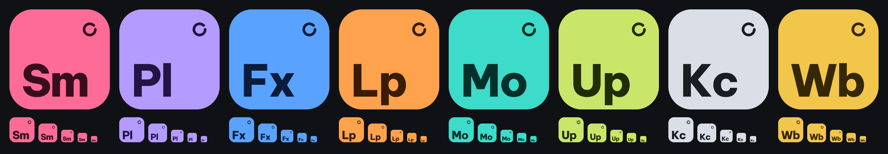

# Bộ logo các app Bokin

Một gia đình logo cho mọi app của công ty (hướng B, chủ dự án chọn ngày 19/10/2026): mỗi app một ô màu riêng, mã
hai chữ màu đậm ở góc dưới bên trái, và **vòng lặp nhỏ** ở góc trên bên phải là dấu hiệu chung của Bokin. Logo nhỏ
hơn 32 điểm ảnh (thanh tác vụ, tab trình duyệt) bỏ vòng lặp cho rõ chữ.



| App | Mã | Màu ô | Màu chữ | File |
|---|---|---|---|---|
| Bokin Studio Music | Sm | `#FF6B97` | `#3A0D1E` | `out/studio-music.*` |
| Bokin Playlist Studio | Pl | `#B49BFF` | `#241446` | `out/playlist-studio.*` |
| Bokin FX | Fx | `#5AA2FF` | `#0B1C3D` | `out/fx.*` |
| Bokin Loop | Lp | `#FFA24D` | `#3A1C04` | `out/loop.*` |
| Bokin Motion Studio | Mo | `#3DDBC9` | `#04302B` | `out/motion-studio.*` |
| Bokin Upscaler | Up | `#C9E66A` | `#222D06` | `out/upscaler.*` |
| Bokin Key Center (nội bộ) | Kc | `#D9DEE7` | `#1A1D23` | `out/key-center.*` |
| Bokin Web (nội bộ) | Wb | `#F2C54B` | `#352805` | `out/web.*` |

## Dùng file nào

- `<app>.ico`: biểu tượng Windows (file .exe, bộ cài, lối tắt). Mỗi cỡ 16 đến 256 điểm ảnh vẽ riêng, không phóng
  một hình.
- `<app>.png`: ảnh 1024 x 1024 nền trong suốt (trang web, tài liệu, gửi khách).
- `<app>.svg`: bản vẽ nét, phóng to bao nhiêu cũng nét (in ấn, thiết kế).
- Trong trang của app (tab trình duyệt, logo góc trên): `small_svg()` cho đoạn SVG ngắn, không vòng lặp.

## Làm lại hoặc thêm app

```
python brand/make_icons.py
```

Ghi lại mọi file trong `out/`. Thêm app: một dòng trong `APPS` của `make_icons.py` (mã chưa ai dùng; màu có sắc khác
các app kia). App mới cần chữ cái nào thì `glyphs.json` đã có đủ A–Z, a–z, 0–9.

Mỗi app tự làm biểu tượng của mình lúc build bằng `write_ico()` (Bokin FX: `packaging/make_icon.py`), chỉ cần Pillow
và numpy.

## Chữ

Be Vietnam Pro ExtraBold (Lâm Bảo, Tony Le, ViệtAnh Nguyễn; Google Fonts), giấy phép SIL Open Font License 1.1: dùng
làm logo được, kể cả bán phần mềm. `glyphs.json` chỉ giữ đường viền các chữ (không phải file font), nên app không cần
cài font.
